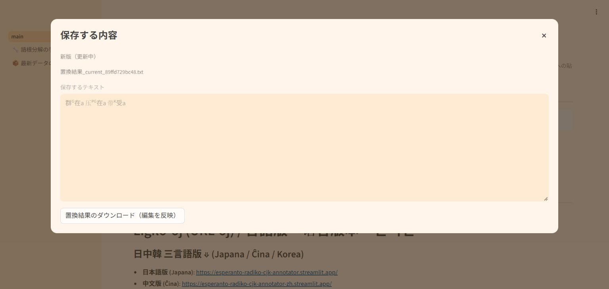

# @指定2試験形の検証結果（2026-10-19）

日中韓の同梱データを使用し、新旧の純粋置換・漢字ルビ・注釈ルビで、小文字の全体指定 `@greganta@` を `greg＋ant＋a`、`@preganta@` を `preg＋ant＋a` として処理します。純粋置換では `群ᴳ在a`・`压ᴾᴳ在a` です。通常変換、`@kordonita@`、空白・複数語・語尾追加を含む別の@指定、自作JSONは従来どおりです。漢字割り当て・識別子・逆変換表は変更していません。

## 全件検証（ローカル実行）

| 検証 | 件数・結果 |
|---|---|
| 保存入力の対象判定を今回実行 | 3,237,944行 |
| 新旧・通常/@・可視漢字の比較範囲 | 12,951,664種類の入力×経路 |
| 全件コーパス中の該当順変換を今回実行 | 16入力×経路 |
| 日中の平文逆変換を今回実行 | 25,903,552回 |
| 差分 | 対象2形の表記差16件、逆変換差0、退行0 |
| 保存済みHTML全文書 | 11,677文書、日中23,354回の実復元、失敗0 |
| 対象の限定補正テスト | 8件成功 |
| 逆変換アプリの既存全試験 | 日本語311件・中国語311件成功 |

全保存入力を実処理と同じ文字正規化・%保護・@捕捉で分類しました。非対象の順変換は、既定API・非対象分岐の構造的な同一性、同梱データ・全有効リストの不変、独立した実例比較を確認してから保存出力を再利用しました。全経路の順変換を今回すべてやり直したという意味ではありません。日中の平文逆変換は、重複を含む保存12,951,776行すべてに対して実行しています。保存済みHTMLの全件確認は残存不一致コーパス11,677文書が対象です。対象2形の旧出力も元々逆変換できたため、今回の成果は逆変換成功件数の増加ではなく、@指定の分解・表示の修正です。

根拠: [全件検証まとめ](audit_completion_validation.json)、[処理・データ同一性](audit_runtime_proof.json)、[全件比較](audit_full_comparison.json)、[保存HTML復元](audit_saved_html_validation.json)。

## 独立した境界・画面検証（ローカル実行）

日中韓×新旧×3モードの18経路で128文脈ずつ、計2,304文脈を比較しました。新しい補正関数を期待値に使わず、変更前エンジンの既存語根・antの別々の@処理を組み立てて照合しました。既定False APIは全18経路で変更前と一致し、対象を含まない1,728文脈も不変でした。%保護、語中、大小文字、語尾追加、メール、識別子、手動/保存補正、自作JSON、並列処理を確認しています。

実アプリのAppTestは、日中韓の対象を使う27回の保存・33件の状態確認が成功しました。既存状態試験はローカル日本語で22回の保存・30件の確認が完了し、日中韓全件は別途[同一ソースのCI](https://github.com/montainternoadorihistorion/esperanto-radiko-cjk-annotator-revision-20261017/actions/runs/39232476274/job/117993483852)で成功しています。CI成功後に中国語ローカル重複実行を止め、韓国語ローカル重複実行は省略しました。途中分はローカル成功件数に含めていません。

加えて日中韓の手動補正ページ18件、自作JSONアップロード6件を確認しました。通信部分や呼び出し記録のみを補助し、変換・状態管理・保存確認は実処理です。[独立レビュー](review/review_summary.json)、[CI状態試験の証跡](review/ci_state_validation.json)

## Streamlit Cloud実測

配備対象コミット: `bc18b11db793a3071d9498d540a11692317963da`。

| 実際に操作した経路 | 件数 |
|---|---:|
| 日中韓の順変換：新旧×pure/漢字ルビ/注釈ルビ | 18 |
| 日中の平文逆変換：新旧 | 4 |
| 日中のHTML復元：日中韓の出力×新旧×2ルビ方式 | 24 |
| 実際に保存したファイルのバイト照合 | 46 |
| 版切替・入力保持などの状態確認 | 5 |

全46経路の保存ファイルを実際に読み、画面で記録した結果およびローカル期待値と照合しました。HTMLは版情報と保存名の署名も確認し、逆変換には対応するCloud順変換の実保存HTMLを入力しています。改行・連続空白・保護された漢字/識別子・@・HTML記号も期待どおりに復元されました。

途中で日本語・中国語の順変換アプリが接続エラー・停止表示となったため、所有者のCloud管理画面から再起動しました。復帰後に残りの経路を実測し、成功を確認しています。日本語旧版の純粋置換の保存待ちも、同じ入力を再変換して実ファイルを取得し直しました。これらに伴う追加のソース・辞書変更はありません。

[Cloud実測と保存ファイルのハッシュ](cloud_validation.json)。これは上のローカル全件検証と別の検証です。Cloud上で約1,295万経路を操作したという意味ではありません。

同じ漢字表記が複数の原文に対応する既存の曖昧さや、通常変換での既存結果は維持しています。
