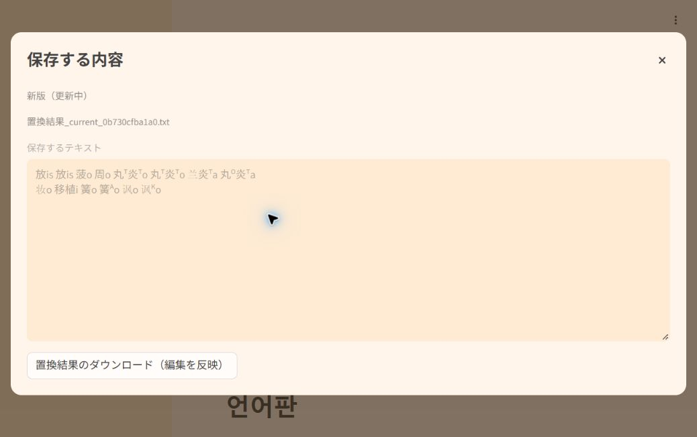

# 入力・保存内容・モード切替の検証

2026-10-18、修正PR #52をマージした `542c2405c949850b666b562deb21e70b203b2566` のCloudアプリで確認した。

## 結果

- 日中韓・新旧・純粋置換／漢字ルビ／注釈ルビの18経路で、通常変換・@変換を含む本文、版の記録、保存ファイル名が期待値と一致。
- 日中・新旧の平文逆変換4経路で、画面・確認本文・実ダウンロードが一致。
- 日中韓で保存した新旧・漢字／注釈ルビHTMLを日中の復元アプリへ入力し、24経路で表示・確認本文・実ファイルが一致。連続空白、改行、保護した漢字・記号・HTML風文字列、大文字を含む。
- 17項目の状態検証が成功。原文編集直後の旧結果保存を拒否し、出力編集直後の内容を保存。平文／HTMLを往復しても原文・版・HTML形式を保持。アップロード原文の保持、明示解除、不正UTF-8への差替え、空ファイルも確認。

## ローカル・自動検証

- 逆変換の全試験はJA311件、ZH311件が成功。辞書同期は各3項目成功。
- 順変換AppTestは保存66項目・入力状態90項目が成功。実ブラウザでも編集直後の保存競合の解消を確認した。
- 保存済みHTML断片11,677件を日中両APIで再検証し、23,354回すべて成功。これは全語根数や任意の外部HTMLの対応件数ではない。
- 辞書、識別子、語根分解、平文逆変換本体、HTML読取処理は不変。代表12順変換・24逆変換も修正前の結果と一致。以前の大規模順変換コーパスは今回再実行せず、使用データ・処理の同一性を確認した。
- [GitHubでの自動検証](https://github.com/montainternoadorihistorion/esperanto-radiko-cjk-annotator-revision-20261017/actions/runs/39134625537)も全成功。

旧版の3試験形と、表記共用による逆変換の曖昧さは今回変更していない。

詳細は `core_validation.json`、`forward_ui_validation.json`、`inverse_ui_validation.json`、`local_browser_validation.json`、`cloud_validation.json`。Cloudの画面更新完了を待って比較し、拡張機能のダウンロード待機が失敗した操作は再確認してから成功件数に含めた。

