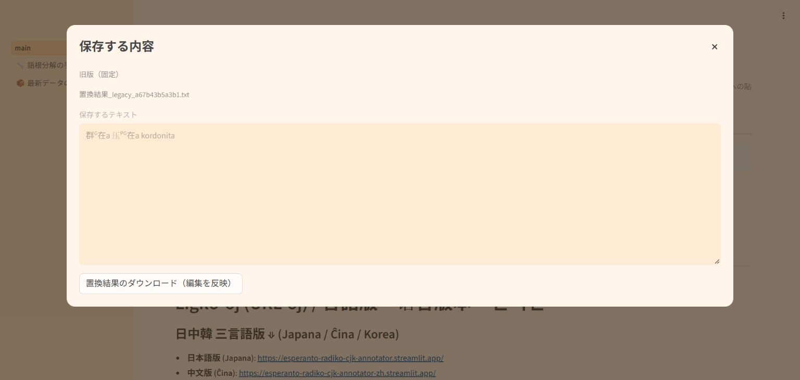

# 旧版3試験形の検証結果（2026-10-19）

旧版の通常・純粋置換に限り、`greganta → 群ᴳ在a`、`preganta → 压ᴾᴳ在a`、`kordonita → kordonita` を確認しました。漢字割り当て・識別子・逆表・語根分解エンジンは変更していません。`@`側の既存分解は別途検討とし、維持しています。

## 全件検証（ローカル実行）

| 検証 | 件数・結果 |
|---|---|
| 旧版pureの順変換を今回実行 | 1,618,905入力 |
| 新旧・通常/@・可視漢字の比較範囲 | 12,951,664種類の入力×経路 |
| 日中の平文逆変換を今回実行 | 25,903,552回 |
| 差分 | 対象3形だけ改善、退行0 |
| 保存済みHTML全文書 | 11,677文書、日中23,354回の実復元、失敗0 |
| 対象/既存ksenのテスト | 9件成功 |
| 逆変換アプリの既存全試験 | 日本語311件・中国語311件成功 |

新版pureと日中韓の漢字ルビ順変換は、処理・データ・有効な置換表の同一性を確認したうえで、以前保存した全件出力を再利用しました。全経路の順変換を今回すべてやり直したという意味ではありません。日中の現行平文逆変換は、重複を含む保存12,951,776行すべてに対して実行しています。HTMLの全件確認は保存済みの残存不一致コーパス11,677文書が対象であり、約1,295万の平文/可視表記経路すべてをHTMLで生成・復元したものではありません。

根拠: [全件検証まとめ](audit_completion_validation.json)、[処理・データ同一性](audit_runtime_proof.json)、[全件比較](audit_full_comparison.json)、[保存HTML復元](audit_saved_html_validation.json)。

## 独立した境界・画面検証（ローカル実行）

日中韓×新旧×3モードの18経路で99文脈ずつ、計1,782文脈を比較しました。旧版pureの承認範囲のみが変化し、残る15経路の全表・出力は同一でした。@、保護、語中、大小文字、未承認の語尾、既存逆キーの衝突、手動補正、自作JSON、並列処理を確認しています。

実アプリのAppTestは、対象3形を使う27回の保存・33件の状態確認と、既存の66回の保存・90件の状態確認が成功しました。入力ファイルとダウンロードの輸送部分のみを置き換え、変換・状態管理・保存確認は実際の処理を使いました。[独立レビュー](review/review_summary.json)

## Streamlit Cloud実測

配備対象コミット: `9eca8c1522f0b9007eeb66be08210cd74b11894e`。

| 実際に操作した経路 | 件数 |
|---|---:|
| 日中韓の順変換：新旧×pure/漢字ルビ/注釈ルビ | 18 |
| 日中の平文逆変換：新旧 | 4 |
| 日中のHTML復元：日中韓の出力×新旧×2ルビ方式 | 24 |
| 実際に保存したファイルのバイト照合 | 46 |
| 版切替・入力保持などの状態確認 | 5 |

全46経路の保存ファイルを実際に読み、画面で記録した結果およびローカル期待値と照合しました。HTMLは版情報と保存名の署名も確認し、逆変換には対応するCloud順変換の実保存HTMLを入力しています。改行・連続空白・保護された漢字/識別子・@・HTML記号も期待どおりに復元されました。

[Cloud実測と保存ファイルのハッシュ](cloud_validation.json)。これは上のローカル全件検証と別の検証です。Cloud上で約1,295万経路を操作したという意味ではありません。

旧版の `g@dominant@a` など、同じ表記が複数の原文に対応する経路は維持しています。保存済みの曖昧な平文を一律に3形へ戻す変更はしていません。
