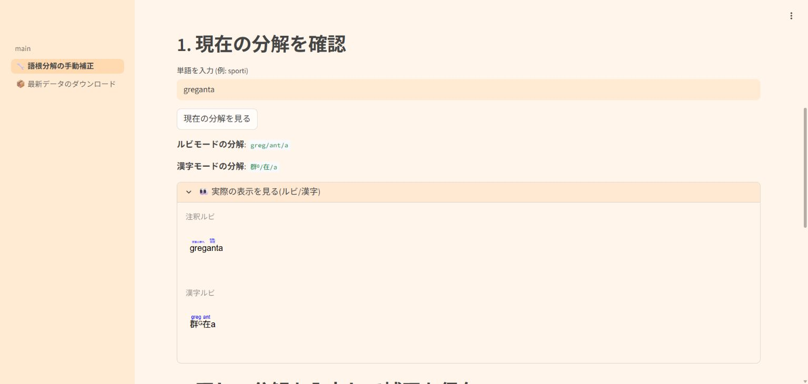

# 手動補正ページの診断・プレビューと言語リンクの検証（2026-10-19）

日中韓の手動補正ページで、メイン画面と同じ保存済み補正・必要時の自動補正を適用し、その最終結果を診断と二つのプレビューに共用するようにしました。画面末尾の言語リンクも、修正版の日本語・中文・한국어アプリへ変更しました。採用理由と対象外の事項は[決定記録](decision.md)にあります。

漢字割り当て、上付き識別子、置換表、通常変換・@変換の分解規則、平文逆変換、HTML復元は変更していません。今回そろえるのは確認ページの表示です。例えば、新旧とも次のようになります（表内のスラッシュは診断上の区切りです）。

| 確認する入力 | 注釈ルビの診断 | 漢字ルビの診断 |
|---|---|---|
| `greganta` | `greg/ant/a` | `群ᴳ/在/a` |
| `preganta` | `preg/ant/a` | `压ᴾᴳ/在/a` |
| `kordonita` | `kordonita` | `kordonita` |
| `@kordonita@` | `kordon/it/a` | `带ᴷ/受/a` |

修正は[PR #58](https://github.com/montainternoadorihistorion/esperanto-radiko-cjk-annotator-revision-20261017/pull/58)で公開リポジトリへ反映しました。マージ後のコミットは `f42a3654763d8bf01018cd9f68067402b373b1a8`、CIと独立レビューで検証した修正ソースは `dd79429283ed256b5bc8a378d2ee46b4ad6724ef` です。

## 通常変換・@変換・逆変換・HTML復元の全件確認

基準は、前回の完全一致@補正を反映済みの `3454d0359282e001d0baa3db6d45e94efe6eb457` です。

| 検証 | 件数・結果 |
|---|---|
| 製品ファイルの比較 | 185件。変更は承認対象6ファイルのみ、他179件は同一 |
| 正本データ | 6件すべて同一 |
| 日中韓のメイン画面 | 変更した3言語URLを戻すと、各ファイルが修正前と完全一致 |
| 保存された順変換結果の比較対象 | 重複を除く12,951,664入力・経路組 |
| 平文逆変換を今回実行 | 保存12,951,776行を日中両方で復元し、25,903,552回。結果差0、退行0 |
| 保存標準HTMLの復元を今回実行 | 11,677文書を日中両方で復元し、23,354回。全件一致 |
| 製品データで新たに順変換 | 日中韓×新旧×3モードの18経路。確定済み出力とバイト単位で一致 |
| 上記の新規出力を復元 | 平文12回、HTML24回。期待値と全件一致 |

全件検証は保存済みの有限コーパスを対象とし、任意のすべての文章での成功を保証するものではありません。約1,295万経路の順変換を今回すべて再実行したわけではありません。エンジン、データ、適用順序、版選択、補正、識別子、逆変換・HTML復元と、メイン画面の変換処理が不変であることを確認して、保存済みの順変換出力を再利用しています。そのうえで、上表の逆変換・保存HTML復元・新規18経路を実際に実行しました。

保存HTML11,677文書は既存の残存不一致群のコーパスです。約1,295万経路すべてのHTMLを再生成したという意味ではありません。純粋置換の全件コーパスは共通処理・データの同値性に基づいて1言語分として数え、日中韓での実出力一致は新規18経路で別途確認しています。従来からの表記共用などによる46,706入力・経路組の不一致は維持され、今回の改善・悪化はいずれも0です。

詳細: [全件検証報告](audit_report.md)、[処理・データの同一性](audit_runtime_proof.json)、[全件比較](audit_full_comparison.json)、[保存HTML復元](audit_saved_html_validation.json)、[新規18経路](audit_fresh_routes.json)、[証拠とソースの最終照合](audit_completion_validation.json)。

## 実際の手動ページとメイン画面の照合

言語ごとに別プロセスでStreamlit AppTestを動かし、実際の画面操作による出力を比較しました。新しい確認用関数を期待値にせず、メイン画面で変換した最終HTMLと、手動ページが表示する二つのプレビューHTMLを直接比較しています。診断文字列も、プレビューの可視部分を独立に読み取って照合しました。

| 検証 | 結果 |
|---|---|
| 日中韓・新旧の手動ページ確認 | 78件成功 |
| 実際のメイン画面での注釈ルビ・漢字ルビ変換 | 156件実行 |
| プレビューHTMLとメイン画面の最終HTML | 156件すべてバイト一致 |
| 表示された診断と実際のプレビュー | 156件すべて一致 |
| 入力中の下書き・セッション補正の保持 | 72件成功 |
| 実際のメイン画面の言語URL | 3画面×3リンク、9件成功 |
| 保存済み補正ファイル | 変更なし |

通常の `greganta`・`preganta`・`kordonita`、それぞれの@指定、`semajno`、`kseno`、`sene`、`testikito`、`orkidita`を新旧で確認しました。手動保存したセッション補正についても、通常変換での優先と既存の@処理の維持を検査しています。保持確認のために入力した試験用の下書き・補正は隔離したテストセッションだけのもので、言語学的な採用や辞書変更ではありません。

独立したソースレビューでは、メイン画面は言語URL以外の変更がなく、手動ページは承認された描画・診断・プレビュー以外の処理が不変であることを確認しました。既存の区切り抽出、入力正規化、下書きへの初期値設定、補正の保存・削除・読み込みは維持しています。指摘事項はありませんでした。

根拠: [独立レビュー集計](review/review_summary.json)、[ソースレビュー](review/source_review.json)、実画面の記録（[日本語](review/app_JA.json)・[中文](review/app_ZH.json)・[한국어](review/app_KO.json)）。Cloudとの比較用に別途作った12件の期待値は、ローカルで取得したもので、Cloudの実測とは区別しています。

## CI

[GitHub Actions run 39239652792](https://github.com/montainternoadorihistorion/esperanto-radiko-cjk-annotator-revision-20261017/actions/runs/39239652792)は全ジョブ成功しました。

| 試験 | 結果 |
|---|---|
| 日本語逆変換アプリ | 311件成功 |
| 中文逆変換アプリ | 311件成功 |
| 入力・保存内容と状態保持 | 1試験・3言語の下位試験、すべて成功 |
| 既存の旧版3形・ksen・完全一致@補正 | 17試験・39下位試験、すべて成功 |
| 今回の手動診断・プレビュー | 1試験・3言語の下位試験、すべて成功 |

今回の試験には、保存補正、自動補正、@・保護文字、識別子、大小文字、任意の自動補正が失敗した場合の一回目の結果の保持を含めています。CIの完了状態と各ジョブのリンクは[CI記録](ci_validation.json)に保存しました。

## Streamlit Cloud

修正版のCloudアプリを接続済みChromeで操作し、次の範囲を確認しました。ダウンロードした50ファイルは、実際の保存バイト列が期待値と一致しています。

| Cloudでの確認 | 結果 |
|---|---|
| 日中韓・新旧の手動確認（単語と複数語） | 12件。診断24件、二つのプレビューHTML24件がローカルの実画面期待値と一致 |
| 画面末尾の言語リンク | 3画面×3リンク、9件一致 |
| 版切替時のメイン画面の原文保持 | 3言語で成功 |
| 日中韓・新旧・3モードの変換とダウンロード | 18件一致。通常・@指定を同じ入力に含め、HTML12件は選択版の記録も一致 |
| 日中・新旧の平文逆変換とダウンロード | 4件一致 |
| 標準HTMLの復元とダウンロード | ローカルの製品処理で生成した日中韓×新旧×2ルビ方式の文書を、日中の逆変換アプリで復元し、24件一致 |
| 今回Cloudから保存したHTMLの復元 | 新版の日本語漢字ルビと旧版の韓国語注釈ルビを、版情報付きの保存内容のまま日中両方で復元し、4件一致 |

HTML復元の入力はソース貼り付けです。今回、ファイルアップロード経路を再検証したという意味ではありません。上記24件はローカル生成の標準HTML、追加4件は今回新たにCloudから保存したHTMLを使っています。平文逆変換4件と標準HTML復元の一部は、変更のない逆変換アプリで配備前から確認し、順変換・手動ページは修正の配備後に確認しました。

Chrome自動操作ではCloud外枠が読み込み中になる現象があり、実際の画面から確認したアプリ内部フレームのURLを使いました。非同期の画面更新待ちとHTMLダウンロード取得2件は再試行後に成功しています。この対応のための追加のソース・辞書変更は行っていません。

別担当の再照合でも、保存50ファイルのハッシュと期待内容がすべて一致しました。手動ページ12件の診断スナップショット、プレビューHTMLの記録ハッシュ24件、言語リンク9件も照合しています。日本語の単語確認ではプレビューを展開した画面を目視確認しました。他の保存スナップショットは折りたたんだ状態で、プレビューの照合はブラウザ内のHTML内容を取得して行っています。

根拠: [Cloud実操作の記録](cloud_validation.json)、[保存証拠の独立照合](review/cloud_evidence_review.json)。

